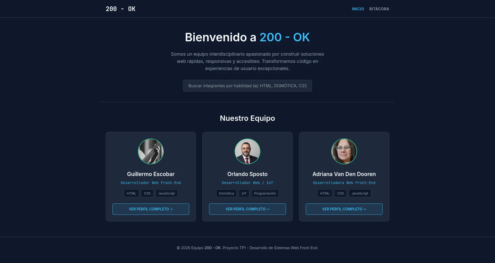
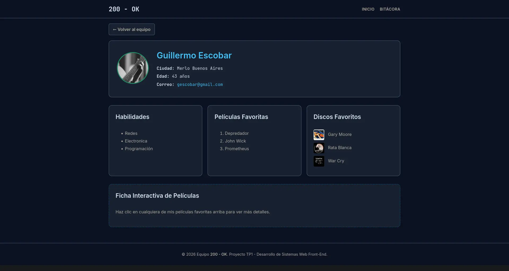
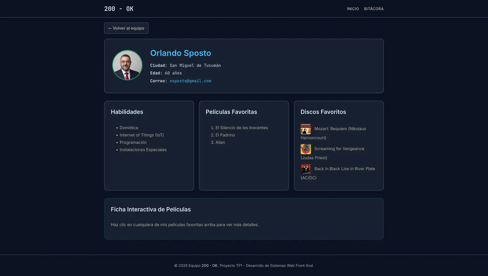
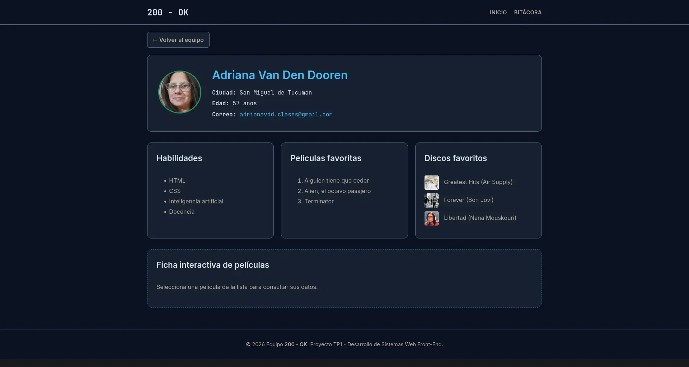

# 200 - OK · Trabajo Práctico 2 (React)

Aplicación web Single Page Application (SPA) desarrollada con **React** y **Vite**, que presenta la identidad del equipo de desarrollo, gestiona un catálogo dinámico de capacidades técnicas, integra servicios web externos en tiempo real y documenta la arquitectura y bitácora del proyecto.

> **Deploy en Producción (Vercel):** [https://dwfe-g2-tp2.vercel.app](https://dwfe-g2-tp2.vercel.app) *(verificable en navegación privada/incógnito)*  
> **Repositorio Oficial:** [https://github.com/osposto/DWFE_G2_TP2](https://github.com/osposto/DWFE_G2_TP2)

---

## 📑 Índice de Navegación Interna

1. [Descripción del Proyecto](#-descripción-del-proyecto)
2. [División de Tareas y Responsabilidades del Equipo](#-división-de-tareas-y-responsabilidades-del-equipo)
3. [Estrategia de Colaboración y Evidencia en Git](#-estrategia-de-colaboración-y-evidencia-en-git)
4. [Estructura y Módulos de la Aplicación en Español](#-estructura-y-módulos-de-la-aplicación-en-español)
5. [Contrato de Interfaces y Rutas para Integración Directa](#-contrato-de-interfaces-y-rutas-para-integración-directa)
6. [Tecnologías y Herramientas](#-tecnologías-y-herramientas)
7. [Declaración Detallada de Uso de Inteligencia Artificial](#-declaración-detallada-de-uso-de-inteligencia-artificial)
8. [Instrucciones de Instalación y Ejecución Local](#-instrucciones-de-instalación-y-ejecución-local)
9. [Capturas de Pantalla](#-capturas-de-pantalla)

---

## 🎯 Descripción del Proyecto

El proyecto constituye la evolución del TP1, transformando un sitio web estático en una **SPA interactiva, reactiva y accesible** gobernada por React 18 y React Router.

La propuesta conceptual y gráfica del equipo **200 - OK** se sitúa en el ámbito de la **Ciberseguridad, Ciberdefensa, Sistemas de Control Industrial (ICS/SCADA) y Sistemas Embebidos**, estructurada en torno a una imagen de fondo técnica panorámica (`fondo-sitio.jpeg`) que evoca una consola de mando / SOC (Security Operations Center) con telemetría en tiempo real, alertas de incidentes críticos y vectores de mitigación.

La aplicación se organiza a través de una barra lateral de navegación persistente (**BarraLateral**) y contempla 6 vistas internas principales:
- **Portada del Equipo:** Presentación colectiva, métricas dinámicas y accesos a perfiles (`/`).
- **Perfiles Individuales:** Rutas dinámicas con interacción funcional por pestañas y modales accesibles para cada integrante (`/perfil/:id`).
- **Catálogo de Capacidades (JSON Local):** 20 competencias técnicas con búsqueda en vivo, filtrado de categorías y detalles desplegables (`/capacidades`).
- **Servicios API:** Consumo asíncrono de GitHub REST API y Hacker News API con manejo explícito de carga, errores y actualización bajo demanda (`/servicios-api`).
- **Árbol de Renderizado:** Jerarquía visual interactiva con nodos expandibles y colapsables del código entregado (`/arquitectura`).
- **Bitácora de Desarrollo:** Registro cronológico estructurado en acordeones colapsables y filtros por categoría/responsable para auditar el proceso de trabajo del equipo (`/bitacora`).

---

## 👥 División de Tareas y Responsabilidades del Equipo

Para garantizar una participación equitativa, modular y verificable, las exigencias del proyecto y los 15 criterios de evaluación se dividieron entre los **3 integrantes** con nombres de elementos estandarizados en español:

| Integrante | Rol en el Proyecto | Perfil GitHub | Módulos y Responsabilidades Técnicas Asumidas |
|---|---|---|---|
| **Orlando Sposto** *(Coordinador)* | **Arquitectura de Software y Lógica de Datos** | [@osposto](https://github.com/osposto) | • Configuración inicial del entorno (Vite, React Router, `vercel.json` para rutas SPA).<br>• Estructura maestra (`ContenedorPrincipal.jsx`) y Barra Lateral persistente (`BarraLateral.jsx`) con drawer móvil responsivo.<br>• Módulo de Datos Locales JSON (`PaginaCapacidades.jsx`, `TarjetaCapacidad.jsx`, `BarraBusqueda.jsx`, `FiltroCategoria.jsx`): catálogo dinámico, búsqueda textual y filtrado.<br>• Componente del Árbol de Renderizado interactivo (`PaginaArbol.jsx`, `NodoArbol.jsx`) con ramas colapsables.<br>• Gestión de despliegue continuo en Vercel. |
| **Adriana Van Den Dooren** | **Diseño UI/UX, Estética y Perfiles de Usuario** | [@Adriana-vandendooren](https://github.com/Adriana-vandendooren) | • Propuesta estética integral del sitio (Nivel `Supera`): definición de paleta cromática, variables CSS en `:root` (`variables.css`), tipografías (`@fontsource/inter` y `@fontsource/jetbrains-mono`) y composición general.<br>• Portada del equipo (`PaginaInicio.jsx`): presentación, estadísticas colectivas y tarjetas de integrantes.<br>• Módulo de perfiles en React (`PaginaPerfil.jsx`, `DetalleIntegrante.jsx`, `TarjetaIntegrante.jsx`): vistas individuales con fotos y datos personales.<br>• Pestañas interactivas con soporte de teclado para habilidades, películas favoritas, discos favoritos y responsabilidades; las películas abren fichas modales accesibles con afiche, año, dirección y sinopsis.<br>• Datos e imágenes optimizadas de los integrantes (`datosIntegrantes.js` y `src/assets/integrantes/`). |
| **Guillermo Escobar** | **Integración de APIs Asíncronas, Bitácora y Documentación** | [@guillermo](https://github.com) *(completar usuario)* | • Módulo de Servicios Web y APIs Externas (`PaginaServicios.jsx`, `SeccionServicios.jsx`, `PestanaGithub.jsx`, `PestanaHackerNews.jsx`): integración asíncrona de GitHub REST API y Hacker News API.<br>• Manejo explícito de estados de red: componentes reutilizables de carga (`Cargando.jsx`), fallo con reintento (`MensajeError.jsx`) y botones de refresco.<br>• Módulo de Bitácora del Proyecto (`PaginaBitacora.jsx`, `AcordeonBitacora`, `datosBitacora.js`): recolección de hitos técnicos, dificultades superadas y maquetación en acordeones interactivos colapsables con filtros.<br>• Redacción técnica y mantenimiento del `README.md` (índice, tabla de roles, tabla de IA y capturas del proyecto). |

---

## 🌿 Estrategia de Colaboración y Evidencia en Git

Para reflejar con claridad el aporte y la autoría de cada miembro en el historial de commits de Git, el equipo sigue el siguiente esquema de trabajo:

1. **Ramas de Trabajo por Módulo:**
   - `feature/arquitectura-barra-datos` *(Orlando)*: Enrutamiento, barra lateral responsiva, catálogo JSON y árbol.
   - `feature/ui-portada-perfiles` *(Adriana)*: Estilos globales (`variables.css`, `global.css`), portada, fichas y tabs de perfiles.
   - `feature/apis-bitacora-docs` *(Guillermo)*: Servicios externos (GitHub/Hacker News), bitácora y documentación.
2. **Identidad de Commits:** Cada integrante firma sus aportes con su respectivo correo y usuario registrado en GitHub, garantizando que el grafo de contribuciones refleje la autoría compartida.
3. **Acceso al Repositorio:** Los 3 integrantes cuentan con rol de colaborador y acceso aceptado al repositorio público de GitHub (Criterio 03).

---

## 🧱 Estructura y Módulos de la Aplicación en Español

```text
DWFE_G2_TP2/
├── public/
│   ├── datos/
│   │   └── capacidades.json             # 20 registros del catálogo técnico
│   └── imagenes/
│       └── fondo-sitio.jpeg             # Imagen de fondo temático (Ciberseguridad / SOC)
├── src/
│   ├── assets/                          # Recursos gráficos de la aplicación
│   │   ├── fondo-sitio.jpeg
│   │   └── integrantes/                 # Fotos, afiches, portadas de música y capturas (.webp)
│   ├── componentes/
│   │   ├── comunes/
│   │   │   ├── Cargando.jsx             # Estado de carga reutilizable
│   │   │   └── MensajeError.jsx         # Mensaje de error con reintento
│   │   ├── estructura/
│   │   │   ├── ContenedorPrincipal.jsx  # Layout maestro (BarraLateral + Outlet)
│   │   │   ├── ContenedorPrincipal.css
│   │   │   ├── BarraLateral.jsx         # Menú lateral persistente + drawer móvil
│   │   │   └── BarraLateral.css
│   │   ├── integrantes/
│   │   │   ├── TarjetaIntegrante.jsx    # Tarjeta de presentación para la portada
│   │   │   └── DetalleIntegrante.jsx    # Perfil completo con pestañas y modal de películas
│   │   ├── datos-locales/
│   │   │   ├── BarraBusqueda.jsx        # Input de filtrado por texto
│   │   │   ├── FiltroCategoria.jsx      # Selector dropdown por categorías
│   │   │   ├── TarjetaCapacidad.jsx     # Tarjeta con detalles desplegables
│   │   │   └── DatosLocales.css
│   │   ├── servicios/
│   │   │   ├── SeccionServicios.jsx     # Contenedor con sistema de pestañas accesible
│   │   │   ├── PestanaGithub.jsx        # Consumo de GitHub REST API
│   │   │   ├── PestanaHackerNews.jsx    # Consumo de Hacker News API
│   │   │   └── SeccionServicios.css
│   │   └── arbol/
│   │       ├── NodoArbol.jsx            # Nodo interactivo colapsable/expandible
│   │       └── VistaArbol.css
│   ├── datos/
│   │   ├── datosIntegrantes.js          # Datos estructurados de los 3 integrantes
│   │   ├── datosBitacora.js             # Entradas e hitos del equipo
│   │   └── capacidades.json             # (Copia accesible localmente)
│   ├── paginas/
│   │   ├── PaginaInicio.jsx             # Portada del equipo (/)
│   │   ├── PaginaPerfil.jsx             # Perfil dinámico (/perfil/:id)
│   │   ├── PaginaCapacidades.jsx        # Catálogo JSON (/capacidades)
│   │   ├── PaginaServicios.jsx          # APIs externas (/servicios-api)
│   │   ├── PaginaArbol.jsx              # Árbol de renderizado (/arquitectura)
│   │   └── PaginaBitacora.jsx           # Bitácora interactiva (/bitacora)
│   ├── estilos/
│   │   ├── variables.css                # Paleta, fuentes y medidas (:root)
│   │   └── global.css                   # Resets, layout de portada y perfiles
│   ├── App.jsx                          # Enrutador central con React Router
│   └── main.jsx                         # Entrada de React y carga de fuentes locales
├── vercel.json                          # Configuración de rewrite para SPA
├── package.json
└── README.md                            # Documentación oficial
```

---

## 🔌 Contrato de Interfaces y Rutas para Integración Directa

Para que el trabajo independiente encaje directamente al unir los módulos, los integrantes respetan el siguiente contrato:

| Componente | Props Esperadas | Exportación | Responsable |
|---|---|---|---|
| `BarraLateral` | `{ estaExpandida, alAlternarExpandir, estaAbiertaMovil, alCerrarMovil }` | `default` | Orlando S. |
| `BarraBusqueda` | `{ valor, alCambiar }` | `default` | Orlando S. |
| `FiltroCategoria` | `{ categorias, seleccionada, alCambiar }` | `default` | Orlando S. |
| `TarjetaCapacidad` | `{ item }` | `default` | Orlando S. |
| `NodoArbol` | `{ nodo, expansionForzada }` | `default` | Orlando S. |
| `TarjetaIntegrante` | `{ integrante }` | `default` | Adriana |
| `DetalleIntegrante` | `{ integrante }` | `default` | Adriana |
| `Cargando` | `{ mensaje }` | `default` | Guillermo |
| `MensajeError` | `{ mensaje, alReintentar }` | `default` | Guillermo |
| `PestanaGithub` | `{ usuario }` | `default` | Guillermo |
| `PestanaHackerNews` | *ninguna* | `default` | Guillermo |

---

## 🛠️ Tecnologías y Herramientas

- **Framework:** React 18
- **Empaquetador y Dev Server:** Vite 5
- **Enrutamiento:** React Router (`BrowserRouter`, `Routes`, `Route`, `NavLink`, `Link`, `Outlet`, `useParams`)
- **Tipografías autoalojadas:** `@fontsource/inter` y `@fontsource/jetbrains-mono`
- **Estilos:** CSS nativo estructurado (Variables `:root`, Flexbox, CSS Grid). *Sin frameworks de utilidades.*
- **APIs Consumidas:** 
  - GitHub REST API (`https://api.github.com/users/:username/repos`)
  - Hacker News Firebase API (`https://hacker-news.firebaseio.com/v0/`)
- **Despliegue Continuo:** Vercel

---

## 🤖 Declaración Detallada de Uso de Inteligencia Artificial

Cumpliendo rigurosamente con los **Criterios 15** y **03** (nivel `Propone`), se detalla el uso de herramientas de IA diferenciando aplicación, modelo específico y tareas asignadas por integrante:

| Integrante | Entorno / Aplicación | Modelo de IA Empleado | Contenido / Tareas Específicas Asistidas |
|---|---|---|---|
| **Orlando Sposto** | Antigravity IDE / VS Code | Gemini 3.8 Flash / Claude 3.5 Sonnet | • Asistencia en la arquitectura de componentes y configuración de rutas anidadas con React Router.<br>• Generación del esquema de datos para `capacidades.json` respetando las 4 categorías equilibradas.<br>• Programación de la lógica del árbol jerárquico colapsable (`NodoArbol.jsx`). |
| **Adriana Van Den Dooren** | ChatGPT / Perplexity | GPT-4o | • Exploración de paleta cromática armónica y sistema de contraste accesible (`variables.css` y `global.css`).<br>• Organización de la información de los perfiles y sus datos de habilidades, películas y música.<br>• Generación de ideas para los componentes interactivos de cada perfil (pestañas dinámicas y modales de películas). |
| **Guillermo Escobar** | Antigravity IDE / VS Code | Gemini / Claude 3.5 Sonnet | • Asistencia en la lógica asíncrona de `fetch` con manejo concurrente (`Promise.all`) para los ítems de Hacker News.<br>• Estructuración del manejo defensivo de errores HTTP (`MensajeError.jsx`) y estados de carga (`Cargando.jsx`).<br>• Redacción de los registros cronológicos y lecciones aprendidas de la bitácora técnica (`datosBitacora.js`). |

---

## 💻 Instrucciones de Instalación y Ejecución Local

1. **Clonar el repositorio:**
   ```bash
   git clone https://github.com/osposto/DWFE_G2_TP2.git
   cd DWFE_G2_TP2
   ```

2. **Instalar dependencias:**
   ```bash
   npm install
   ```

3. **Iniciar el servidor de desarrollo:**
   ```bash
   npm run dev
   ```

4. **Compilar para producción:**
   ```bash
   npm run build
   ```

---

## 📸 Capturas de Pantalla

Vista general de la aplicación en funcionamiento y de las interacciones en los perfiles de integrantes (Criterio 02 - Nivel `Propone`):

### 1. Portada del Equipo y Catálogo Interactivo


### 2. Perfiles de Integrantes y Fichas Modales Interactivas
| Perfil de Orlando Sposto | Perfil de Adriana Van Den Dooren | Perfil de Guillermo Escobar |
|---|---|---|
|  |  |  |
